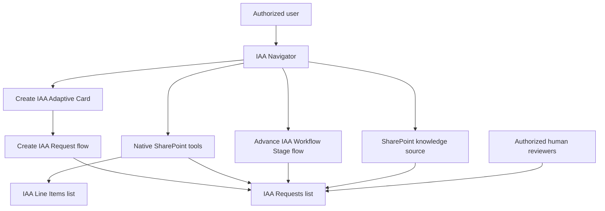

# IAA Navigator

## Overview

**IAA Navigator** is an independent Microsoft Copilot Studio agent for creating,
preparing, looking up, updating and tracking Interagency Agreement (IAA)
request packages. It combines conversational assistance, a request-intake
card, SharePoint records and two Power Automate flows.

This is the complete customer README. Tenant setup, SharePoint schemas,
connections, tools, workflow stages, example prompts, acceptance,
publication and operations are documented together on this single page.
No separate deployment or component guide is required.

The agent helps requestors, agreement coordinators, OPS staff, budget
reviewers and other authorized personnel find the current request
information and perform supported updates one step at a time.

IAA Navigator supports human judgment. A request, a completed checkbox or a
workflow transition is not an executed agreement, approval, signature or
authority to obligate funds. Authorized personnel retain those decisions
and must verify the supporting evidence.

## Customer start here

**Installation package:** this section currently provides exported solution
source, not a qualified customer installation ZIP. GitHub **Download ZIP**
downloads source; it does not create an importable Power Platform solution.
Obtain a validated package with its dependencies resolved before importing.

Start in an approved isolated test environment. Prepare the two SharePoint
lists, configure your destination connections, replace the source-specific
site/list bindings, and complete the acceptance checks before publication.
IAA Navigator uses the standard SharePoint connector; there is no separate
custom-connector bootstrap package.

**Import control:** the source configuration sets `publishOnImport: true`.
The deployment owner must verify a publication-safe artifact and import
procedure. Do not assume an import leaves the agent unpublished.

The [current implementation limitations](#current-implementation-limitations)
explain the creation-field mappings, Request ID generation, requirement
coverage and other behavior that must be addressed in the deployable
package. These are not fixed by changing a prompt.

IAA Navigator is an independent agent with its own destination connections
and agreement lists. Deploying another agent is not a prerequisite.

| Start here | What you will find |
|---|---|
| [Capabilities and boundaries](#capabilities-and-boundaries) | Supported request, line-item and workflow operations |
| [Architecture and data boundaries](#architecture-and-data-boundaries) | Agent, flows, tools, knowledge and SharePoint relationships |
| [Prepare the destination](#prepare-the-destination) | Environment, owners, permissions and installation prerequisites |
| [Deploy to your tenant](#deploy-to-your-tenant-step-by-step) | Ordered preparation, import, configuration and publication steps |
| [Native tools and connector behavior](#native-tools-and-connector-behavior) | Ten active tools, standard connector operations and connection modes |
| [Topics and inactive components](#topics-and-inactive-components) | Active dialogs, legacy components and safe configuration |
| [Create an IAA request](#create-an-iaa-request) | Intake card, business branches and saved field values |
| [Request IDs](#request-ids-and-sharepoint-item-ids) | Business IDs versus numeric SharePoint row IDs |
| [Agreement lifecycle](#agreement-lifecycle-and-stage-gates) | Exact stage sequence, gates, owners and next actions |
| [Flow contracts](#flow-contracts) | Creation and advancement inputs, outputs and failure boundaries |
| [SharePoint data model](#sharepoint-data-model) | Both complete list schemas and exact choice values |
| [Authentication and connections](#authentication-connections-and-permissions) | User access, flow identity, logical references and data protection |
| [Acceptance checklist](#acceptance-checklist) | Required destination and channel checks |
| [Example prompts](#example-prompts) | Copyable read-only and write examples |
| [Troubleshooting](#troubleshooting) | Import, routing, field, ID, permission and workflow issues |
| [Operations, upgrades and rollback](#operations-upgrades-and-rollback) | Ownership, monitoring, controlled releases and recovery |
| [Current implementation limitations](#current-implementation-limitations) | Package requirements and behavior to resolve before rollout |
| [Source reference](#source-reference) | Optional implementation files; no separate customer guide required |

## Capabilities and boundaries

| User need | Implementation | Important boundary |
|---|---|---|
| Start a request | Active **Create IAA Adaptive Card** topic and Create IAA Request flow | Submitting the card writes a record; several collected fields are not persisted as entered |
| Review a request | **Get IAA Request** native SharePoint tool | Use the actual business Request ID; do not invent missing fields |
| Review related costs | **Get IAA Line Items** | Match each line item's `IAARequestID` to the request's `RequestID` |
| Add a service or cost line | **Add IAA Line Item** | Writes immediately; amounts and parent ID must come from authorized inputs |
| Update customer funding-official details | **Update IAA Request** | Updates only the official's name/email, not arbitrary request fields |
| Record selected completed requirements | Five dedicated completion tools | Only record the explicitly confirmed requirement |
| Advance the lifecycle | **Advance IAA Workflow Stage** flow tool | A write operation, not a dry run or eligibility-only check |
| Explain request information | Instructions, tools and SharePoint knowledge source | Stored records and actual flow results take precedence over model-generated explanations |

IAA Navigator does not implement a signature service, a financial transaction
system, a replacement for an approval authority, or automatic verification
that a human actually completed a review. The two flows do not send
approvals, obtain signatures, process payments or transfer billing documents.
They create/update SharePoint request records and return workflow messages.

## Architecture and data boundaries



The two lists are the operational data stores. The line-item relationship is
a text business-ID relationship, not a SharePoint lookup column
or an automatically enforced foreign key.

The exported configuration lists Teams and Microsoft 365 Copilot channels,
uses generative orchestration, and enables model knowledge, file analysis
and semantic search. It has `contentModeration: Low` and
`optInUseLatestModels: true`. Review these source defaults against your
information-handling requirements and available cloud features rather than
assuming they are appropriate for your destination.

The knowledge source points to the request list. It is not a separate
agreement database, a guaranteed live transaction query, or a substitute
for verifying current records with the structured tools.

Model knowledge is different from public web search. Review public web
search and knowledge-source access separately when configuring your agent.

## Native tools and connector behavior

The solution includes **ten active native tools**.
The component suffix identifies the source folder under
`botcomponents/cr8ac_agentuyyEN6.`.

| Tool shown to orchestration | Component suffix | Operation | Reads or writes |
|---|---|---|---|
| Get IAA Request | `action.SharePoint-Getitems` | SharePoint `GetItems` on requests | Read |
| Get IAA Line Items | `action.SharePoint-Getitems_ylc` | SharePoint `GetItems` on line items | Read |
| Add IAA Line Item | `action.SharePoint-Createitem` | SharePoint `PostItem` | Write |
| Update IAA Request | `action.SharePoint-Updateitem` | SharePoint `PatchItem` | Write: `CustomerFundingOfficialName`, `CustomerFundingOfficialEmail` |
| Mark OPS Review Complete | `action.SharePoint-Updateitem_5Xh` | SharePoint `PatchItem` | Write: `OPSReviewComplete` |
| Mark Budget Submitted | `action.SharePoint-Updateitem_9B6` | SharePoint `PatchItem` | Write: `BudgetSubmitted` |
| Mark Internal Signatures Complete | `action.SharePoint-Updateitem_A0f` | SharePoint `PatchItem` | Write: `SignaturesComplete` |
| Mark Customer Signatures Complete | `action.SharePoint-Updateitem_hbu` | SharePoint `PatchItem` | Write: `CustomerSignaturesComplete` |
| Mark Billing Complete | `action.SharePoint-Updateitem_Wpl` | SharePoint `PatchItem` | Write: `BillingComplete` |
| Advance IAA Workflow Stage | `action.Untitled` | Invoke the advancement flow | May update stage, owner and next action |

Some solution component display names are generic, such as **SharePoint -
Update item** or **Untitled**. The meaningful orchestration names above come
from each tool's `modelDisplayName`; generic names do not by themselves mean
those active tools are unused.

### Direct SharePoint tools

The direct tools have fixed site/list inputs in the export and use
`connectionProperties.mode: Invoker`. They require a destination connection
and appropriate SharePoint access. Rebinding the connection alone does not
replace those fixed site/list inputs.

The two `GetItems` tools do not define a request-specific OData filter in
their input bindings. Do not assume that mentioning a Request ID
restricts the server-side query to that one request, that a single result is
guaranteed, or that all rows are retrieved beyond connector limits. The
destination design must qualify filtering, pagination, list size and access
scope before rollout.

The Add IAA Line Item tool supplies these business inputs:
`IAARequestID`, `ServiceName`, `UnitCost`, `Quantity`, `AnnualCost`,
`CostCenter` and `VendorProvided`. Other list columns are not explicitly
populated by this tool. No automatic annual-cost calculation or parent
request total aggregation is implemented in this tool path.

### Workflow tools

The advancement tool is marked `Invoker` at the agent action boundary, but
both flow definitions use an **embedded SharePoint connection**
with `runtimeSource: embedded`. Do not infer that every underlying flow
write is automatically performed with the chatting user's SharePoint
permissions. Review the flow's actual connection, invocation permissions
and business authorization separately.

No separate custom connector registration, custom-connector API key or
connector-bootstrap solution is supplied for IAA Navigator. The unresolved
flow connection-reference dependency described below is still required.

## Topics and inactive components

### Active topics

There are **fourteen active dialog topics**, distinct from the ten native
tools.

| Category | Active topic names |
|---|---|
| Request intake | Create IAA Adaptive Card |
| Standard conversation | Greeting; Goodbye; Thank you; Start Over |
| System behavior | Conversation Start; Conversational boosting; End of Conversation; Escalate; Fallback; Multiple Topics Matched; On Error; Reset Conversation; Sign in |

Standard system topics handle sign-in, errors, conversation lifecycle and
fallback behavior. A tools-based implementation can still require these
topics; they are not all obsolete business dialogs.

### Inactive export components

The exported solution retains the following four **inactive components**.
They are not active features.

| Component suffix | Name/purpose | Deployment treatment |
|---|---|---|
| `topic.CreateNewIAA` | Older question-by-question Create New IAA dialog | Leave inactive; the active intake path is the adaptive card |
| `topic.UpdateIAAStatus` | Legacy Update IAA Status dialog | Leave inactive; its stage vocabulary differs from the current lifecycle and it contains no completed update action |
| `action.SharePoint-Updateitem_Ndh` | Advance IAA Stage, directly changing owner/next action | Leave inactive; use the flow-backed advancement path |
| `action.SharePoint-Updateitem_ULR` | Broad Update IAA Requirement action | Leave inactive; do not re-enable merely to obtain a missing checkbox tool |

Do not delete active system topics or re-enable legacy components as an
installation shortcut. Any later cleanup should check references,
dependencies and regression behavior in development before a new package
is produced.

The current instructions still name **Create New IAA**, although that
specific legacy dialog is inactive and the card topic is active. Align the
instructions with the accepted intake path and qualify routing in a future
implementation release. Seeing a topic on the maker overview does not prove
it is active or that creation has passed an end-to-end test.

There is **no active dedicated Vendor Quote Received update tool** in the
tool inventory. The broader requirement updater is inactive. An
authorized owner must use an approved record-maintenance process or provide
a separately qualified implementation; do not promise that every requirement
can currently be updated through chat.

## Create an IAA request

The active intake topic presents an Adaptive Card version 1.5.

### Information collected

| Common fields | Notes |
|---|---|
| Project title | Required by the card |
| Short project description | Required by the card |
| Quote source | Vendor Quote; Manual Cost Breakdown; Mixed |
| Customer agency | Required by the card |
| Requestor name | Required by the card |
| Requestor email | Card includes email-format validation |

Select one business funding type to reveal its fields:

| Branch | Fields collected |
|---|---|
| Intrafund (SSF) | PRICES Customer Code; Customer Program Official Name/Email; Customer Funding Official Name/Email |
| Non-Intrafund (Non-SSF) | Requesting Agency Group Name; Agency Location Code (ALC); Number of CANs |

The non-intrafund card specifies a minimum Number of CANs of 1. The
intrafund submission supplies blank agency-group/ALC values and CAN count
0. The non-intrafund submission supplies blank official/PRICES fields.
Client-side card validation is not a substitute for server-side validation.

### What the current flow actually stores

Selecting **Create IAA request** invokes the flow; this is not a preview-only
form. The flow creates the SharePoint item, generates a business ID, patches
that ID onto the item, and responds after the patch succeeds.

| Value | Current implementation |
|---|---|
| `Title`, `ProjectTitle` | Submitted project title |
| Customer agency, requestor and branch-detail fields | Mapped from the corresponding flow inputs |
| `Status` | Fixed to `Draft` |
| `AgreementStage` | Fixed to `Customer Completion` |
| `FundingType` | Fixed to `Intrafund (SSF)`, regardless of the card selection |
| `QuoteSource` | Fixed to `Vendor Quote`, regardless of the card selection |
| `VendorQuoteReceived`, `CustomerFormReturned` | Both set to `true` |
| `BudgetSubmitted`, `SignaturesComplete`, `BillingComplete` | Set to `false` |
| Project description | Collected and passed to the flow, but not written to `ProjectDescription` |
| `CurrentOwner`, `NextAction`, `OPSReviewComplete`, `CustomerSignaturesComplete` | Not explicitly initialized by this create action; do not invent populated values |

The card's `FundingType` and `QuoteSource` are not passed into the current
flow contract. This is a verified implementation gap, not an instruction to
choose different wording in the prompt. Non-intrafund and non-vendor-quote
intake must not be presented as correctly persisted until corrected and
accepted in a separate implementation change.

The returned success fields are Request ID, Status and Current Stage.
If the flow fails, times out or returns no usable result, do not claim that
nothing was created: the create and later ID-patch steps are separate.
An authorized operator should check for partial completion before retrying,
to avoid duplicate requests.

## Request IDs and SharePoint item IDs

| Identifier | Meaning | Where used |
|---|---|---|
| Business Request ID | Human-facing text such as `IAA-2027-001` | Request lookup, line-item association, advancement flow input |
| SharePoint item `ID` | Numeric ID of a row in one particular list | Direct `PatchItem` tools and internal flow updates |

Never pass a business ID string into a numeric item-ID input. Retrieve the
correct request first, verify its business ID, and use that returned row's
numeric `ID` for a patch. A line-item row has its own numeric ID, which is not
the parent request row's numeric ID.

**Current generator limitation:** the creation flow uses a fixed
`IAA-2027-` prefix and only the last three characters of a zero-padded
SharePoint item ID. It does not calculate the year from the current date or
an agency fiscal-year rule. Item IDs 1 and 1001 would both produce
`IAA-2027-001`. This algorithm needs a uniqueness-preserving replacement and
acceptance testing before a new customer deployment.

The advancement flow filters `RequestID` and takes only the first matching
row. Duplicate business IDs therefore cannot be treated as harmless.
Do not select a record by project title alone when the match is ambiguous.

## Agreement lifecycle and stage gates

`AgreementStage` is the workflow-stage field. `Status` is a separate choice
field with a different vocabulary. Do not silently substitute one for the
other in an answer or in SharePoint configuration.

An invocation can advance **at most one stage**, not through the entire
lifecycle in one call.

| Current Agreement Stage | Gate actually checked | Next stage | Owner set on success | Next action set on success |
|---|---|---|---|---|
| Customer Completion | No completion flag checked in this branch | Quote Generation | Agreement Coordinator | Generate and review vendor quote |
| Quote Generation | `VendorQuoteReceived = true` | OPS Completion | OPS | Complete OPS review and required agreement information |
| OPS Completion | `OPSReviewComplete = true` | Budget Submission | OCFO | Prepare and submit agreement for budget review |
| Budget Submission | `BudgetSubmitted = true` | Internal Signatures | Internal Approvers | Obtain required internal signatures |
| Internal Signatures | `SignaturesComplete = true` | Customer Signatures | Customer Agency | Obtain required customer signatures |
| Customer Signatures | `CustomerSignaturesComplete = true` | Billing Transfer | Agreement Coordinator | Transfer completed agreement for billing |
| Billing Transfer | `BillingComplete = true` | Completed | Agreement Coordinator | Complete billing transfer and close the IAA |
| Completed | Already complete | No further transition | No update in this branch | No update in this branch |

The internal-signature column is named **`SignaturesComplete`**, not
`InternalSignaturesComplete`. Customer signatures have their own distinct
`CustomerSignaturesComplete` column.

For a failed Boolean gate, the flow returns a message naming that stage's
missing requirement and does not perform that branch's stage update.
The Customer Completion branch does not check `CustomerFormReturned`;
the Quote Generation branch relies on a flag that creation currently sets
to true. These are actual checks, not a complete institutional approval
policy.

### Advancement is a mutation, including eligibility-style questions

The agent instructions route advancement, eligibility and blocker questions
to **Advance IAA Workflow Stage**. That flow has no dry-run input. A question
such as "Can this IAA advance?" may therefore cause a stage update when its
gate is satisfied.

For a read-only review, ask for stored Status, Agreement Stage, owner,
next action and flags, and explicitly say **do not advance or update
anything**. This wording expresses intent; it is not an independent
authorization control. Qualify routing with representative users before
deployment.

After an authorized advancement, retrieve the record again to confirm its
new stage. The flow returns `previousstage`, not a structured new-stage
field. It updates Agreement Stage, Current Owner and Next Action, but does
**not** update `Status`; a request can therefore have stage `Completed`
while its stored Status remains `Draft`.

The current flow has no explicit not-found/duplicate-record handling or
structured error result. An unknown stage can reach the empty default
switch branch. Empty results and failed lookups must not be converted into
invented blockers, invented success or a statement that all requirements
are complete.

## Flow contracts

The two definitions are in [modernflows](modernflows/). Their logical
contracts below are more useful for deployment than their source-tenant
workflow GUIDs; verify the destination bindings after import.

### Create IAA Request

Trigger: request/Skills invocation from the active intake topic.
The current trigger marks **all thirteen inputs required**, including the
branch-detail inputs that the card submits as blank strings or zero when
not applicable.

| Trigger property | Logical input |
|---|---|
| `text` | ProjectTitle |
| `text_1` | ProjectDescription |
| `text_2` | PRICESCustomerCode |
| `text_3` | CustomerProgramOfficialName |
| `text_4` | CustomerAgency |
| `text_5` | RequestorName |
| `text_6` | RequestorEmail |
| `text_7` | CustomerProgramOfficialEmail |
| `text_8` | CustomerFundingOfficialName |
| `text_9` | CustomerFundingOfficialEmail |
| `text_10` | AgencyGroupName |
| `text_11` | AgencyLocationCode |
| `number` | NumberOfCANs |

| Response property | Current successful value |
|---|---|
| `message` | `IAA request successfully created.` |
| `requestid` | Generated business ID |
| `currentstage` | `Customer Completion` |
| `status` | `Draft` |

Execution order is Create item -> Generate Request ID -> Update item ->
Respond to Copilot. The response is configured after the ID update
succeeds. There is no separate catch/rollback or idempotency
mechanism for the multi-step create path.

### Advance IAA Workflow Stage

| Direction | Property | Meaning |
|---|---|---|
| Input | `text` | Business IAARequestID, not numeric item ID |
| Output | `requestid` | Input business ID |
| Output | `previousstage` | Agreement Stage read before the switch |
| Output | `result` | Human-readable advancement, blocker or already-complete message |

Execution order is Get items with the business-ID filter and `$top: 1` ->
take the first row -> read Agreement Stage -> initialize result text ->
execute the stage switch -> respond.

The response schema has no `success` Boolean, machine-readable blocker
code, new-stage field or read-only-mode flag. Do not document such fields
as available. Failed connector operations do not become a reliable
structured business-blocker response.

## SharePoint data model

Create two destination lists, **IAA Requests** and **IAA Line Items**.
Preserve the internal column names below, not merely the friendly labels.
The types and choices below match the fields used by the flows and direct
tools.

Configure list-level validation and indexes explicitly. The card's required
prompts do not make a SharePoint column required or indexed. Do not assume
the lists enforce complete intake, unique Request IDs or workflow
authorization.

Built-in SharePoint fields such as numeric `ID`, Created, Modified,
Created By and Modified By are supplied by SharePoint. Do not replace them
with custom columns. `Title` is included below because tools/flows may
use it even though it is a standard field.

### IAA Requests columns

| Display name | Exact internal name | SharePoint type | Purpose |
|---|---|---|---|
| Title | `Title` | Text | Set from project title by the create flow |
| Request ID | `RequestID` | Text | Business identifier; not numeric row ID |
| Status | `Status` | Choice | Separate record-status vocabulary below |
| Customer Agency | `CustomerAgency` | Text | Customer organization |
| Project Title | `ProjectTitle` | Text | Project/request title |
| Project Description | `ProjectDescription` | Note | Description column; current create flow does not populate it |
| Requestor Name | `RequestorName` | Text | Requestor name |
| Requestor Email | `RequestorEmail` | Text | Email text, not a Person field |
| Funding Type | `FundingType` | Choice | Business intake branch |
| Total Cost | `TotalCost` | Currency | No automatic line-item aggregation qualified here |
| OPS PM | `OPSPM` | User | SharePoint Person field |
| OPS Director | `OPSDirector` | User | SharePoint Person field |
| Customer Funding Official | `CustomerFundingOfficial` | Text | Legacy/general field, distinct from name/email pair |
| Customer Budget Approver | `CustomerBudgetApprover` | Text | Stored approver information |
| Vendor Quote Received | `VendorQuoteReceived` | Boolean | Quote Generation gate |
| Customer Form Returned | `CustomerFormReturned` | Boolean | Stored indicator; not checked by the current first transition |
| OPS Review Complete | `OPSReviewComplete` | Boolean | OPS Completion gate |
| Budget Submitted | `BudgetSubmitted` | Boolean | Budget Submission gate |
| Signatures Complete | `SignaturesComplete` | Boolean | Internal Signatures gate |
| Customer Signatures Complete | `CustomerSignaturesComplete` | Boolean | Customer Signatures gate |
| Billing Complete | `BillingComplete` | Boolean | Billing Transfer gate |
| Current Owner | `CurrentOwner` | Text | Role/owner text written by stage flow |
| Next Action | `NextAction` | Note | Action text written by stage flow |
| PRICES Customer Code | `PRICESCustomerCode` | Text | Intrafund details |
| Customer Program Official Name | `CustomerProgramOfficialName` | Text | Intrafund contact |
| Customer Program Official Email | `CustomerProgramOfficialEmail` | Text | Intrafund contact email |
| Customer Funding Official Name | `CustomerFundingOfficialName` | Text | Intrafund contact; supported update tool field |
| Customer Funding Official Email | `CustomerFundingOfficialEmail` | Text | Intrafund contact; supported update tool field |
| Agency Group Name | `AgencyGroupName` | Text | Non-intrafund details |
| Agency Location Code (ALC) | `AgencyLocationCode_x0028_ALC_x00` | Text | Preserve this exact encoded internal name |
| Number of CANs | `NumberofCANs` | Number | Note lowercase `of` in the list's internal name |
| Process Path | `ProcessPath` | Choice | Stored business process route |
| Agreement Stage | `AgreementStage` | Choice | Lifecycle stage, distinct from Status |
| Quote Source | `QuoteSource` | Choice | Intake quote-source category |

### IAA Requests choice values

| Column | Observed choices |
|---|---|
| `Status` | Draft; Quote Received; Customer Review; Customer Returned; OPS Review; Budget Processing; Awaiting Signatures; Signatures Complete; Billing Processing; Completed; On Hold; Cancelled |
| `FundingType` | Intrafund (SSF); Non-Intrafund (Non-SSF) |
| `ProcessPath` | CAM; G-Invoicing |
| `AgreementStage` | Customer Completion; Quote Generation; OPS Completion; Budget Submission; Internal Signatures; Customer Signatures; Billing Transfer; Completed |
| `QuoteSource` | Vendor Quote; Manual Cost Breakdown; Mixed |

The observed list presents Quote Generation before Customer Completion in
its choice ordering. That ordering does not define the workflow: the flow
creates at Customer Completion and follows the lifecycle table above.
Do not replace Agreement Stage choices with the legacy Status choices.

### IAA Line Items columns

| Display name | Exact internal name | SharePoint type | Purpose |
|---|---|---|---|
| Title | `Title` | Text | Standard list title |
| IAA Request ID | `IAARequestID` | Text | Parent's business Request ID |
| Service Name | `ServiceName` | Text | Product/service description |
| Cost Type | `CostType` | Choice | Cost category |
| Unit Cost | `UnitCost` | Currency | User-supplied unit amount |
| Quantity | `Quantity` | Number | User-supplied quantity |
| Billing Frequency | `BillingFrequency` | Choice | Billing interval |
| Annual Cost | `AnnualCost` | Currency | Stored user-supplied annual amount, not a calculated column |
| Cost Center | `CostCenter` | Text | Business accounting reference |
| Account Type | `AccountType` | Choice | Business account category |
| Vendor Provided | `VendorProvided` | Boolean | User-confirmed indicator |

| Column | Observed choices |
|---|---|
| `CostType` | License; Service; Hardware; Subscription; Professional Services; Other |
| `BillingFrequency` | Monthly; Annual; One Time |
| `AccountType` | Passthrough; Operational |

The Add IAA Line Item tool does not explicitly bind `Title`, `CostType`,
`BillingFrequency` or `AccountType`. Do not imply that these are collected
or reliably populated through that tool. Check the stored record and use
an authorized maintenance process for fields outside the current tool.

### Column-creation precautions

When creating columns manually, establish the intended internal name first,
then set its friendly display label. Renaming a column's label later does
not change its internal name. For encoded/truncated names such as the ALC
column, use a supported, controlled provisioning process and verify the
result rather than assuming a typed display name produces a match.

After connecting to new lists, refresh the connector schema and verify
every mapping. Currency formatting, decimal precision, defaults, unique
constraints, list permissions, versioning, retention and large-list
behavior require destination qualification; matching names alone is not
enough.

## Authentication, connections and permissions

### Agent authentication and sharing

Configure integrated authentication and require users to sign in.
Authentication does not grant SharePoint access or select the correct user
audience automatically.

Before publication, configure the intended users/groups, run an agent
evaluation, and verify both permitted and denied users. Share with the
whole organization only when that audience is approved for the agent's
content and actions. Agent sharing, direct list permissions and flow
invocation permissions are separate controls.

Assign and review these responsibilities separately:

| Role | Required responsibility |
|---|---|
| Power Platform administrator | Approve the destination environment, policies, solution dependencies and connector availability |
| Agent/solution owner | Configure and review instructions, tools, sharing, channels and publication |
| SharePoint owner | Provision both lists, verify schema, permissions, versioning and retention |
| Flow owner | Bind and maintain the embedded connection and validate invocation authorization |
| Authorized agreement personnel | Verify evidence and perform only their permitted business updates |
| Acceptance reviewer | Independently confirm behavior for permitted and denied users |

Direct tools require the appropriate authenticated user's list access.
Embedded flow connections require separate scrutiny: a user who cannot
directly edit a list must not be assumed unable to invoke an owner-bound
write flow. Validate this with permitted and denied test identities.

### Connection references

These are logical reference names, **not** credentials or destination
connection-instance IDs.

| Logical name | Role |
|---|---|
| `cr8ac_agentuyyEN6.shared_sharepointonline.shared-sharepointonl-0e9ff7e3-bc69-41de-9064-c3dac51493b4` | Referenced by the direct SharePoint tools |
| `cr8ac_agentuyyEN6.shared_sharepointonline.shared-sharepointonl-4ffb9aed-c43d-491a-8760-160d9be1c44c` | Additional exported agent SharePoint reference; review usage before removal |
| `cr8ac_sharedsharepointonline_5f0fc` | Required by both flows; listed as a missing dependency in the source solution metadata |

The source contains definitions for the two agent-scoped references but
does not provide the flow reference as a closed, self-contained solution
dependency. A maintainer must include/resolve that reference in the
qualified package. Do not assume a fresh environment already has it.

There are no documented destination environment-variable definitions in
this export for replacing the fixed site/list routing. Update all affected
flow actions, native-tool inputs and the knowledge source deliberately.

### Data protection

Use the approved SharePoint site and the smallest appropriate access scope.
Separate makers from ordinary users, confirm DLP policy allows the required
connector/flow usage, and apply your organization's agreement-record,
contact-information and retention rules.

Prompts and model instructions are not row-level security or business-role
authorization. Qualify data access, tool invocation and owner-bound flow
writes as separate controls. Do not place credentials, private exports,
connection tokens or real agreement/contact records in GitHub or example
prompts.

## Prepare the destination

**Current distribution:** exported source only. There is no IAA customer ZIP,
release hash or automated list provisioner in this section. GitHub **Download ZIP**
downloads source; it does not produce an importable Power Platform solution.

Complete these prerequisites before the installation sequence below.

| Before starting | Required evidence |
|---|---|
| Destination environment | An approved isolated test environment with the required Copilot Studio, Power Automate, Dataverse solution and SharePoint capabilities available in its cloud |
| Owners and access | Named solution, flow and SharePoint owners with the permissions needed for their tasks |
| Data handling | Approved site, user audience, connector/DLP policy and agreement-data handling rules |
| Installer | A maintainer-produced, importable solution ZIP with dependencies closed and known behavior gaps resolved or formally accepted within a restricted scope |
| Schema | Destination lists and verified internal names/types/choices |
| Publication control | Import/release process that cannot publish the agent unexpectedly |
| Acceptance plan | Isolated test data, allowed/denied users, stage-gate cases and rollback ownership |

**Import and publication control:** the source configuration has
`publishOnImport: true`. The maintainer must provide a destination-safe
artifact/import procedure; do not assume an import leaves the agent
unpublished.

## Deploy to your tenant step by step

### Step 1 - Select the destination and assign owners

Open the Power Platform maker/admin portals appropriate to your cloud.
Select the intended **isolated test** environment explicitly and record
its identity privately. Do not assume the current default environment is
the intended destination.

Assign the solution, flow, SharePoint and acceptance owners. Confirm the
target channels and users are supported in that environment. Keep real
tenant routing and connection details in the deployment record, not in this
README.

### Step 2 - Obtain a qualified solution from the maintainer

**Before import:** obtain a validated solution ZIP from the maintainer.
This section does not currently include one.

The authorized maintainer should use the supported Power Platform solution
export/build process to prepare and validate the deployable package in an
approved development environment.

Include the agent, required components, both flows and their connection
references. Resolve the missing flow reference. Review the
`publishOnImport` behavior, tenant-specific routing and the known behavior
gaps before producing a customer artifact. Do not treat the repository
folder, a template-extraction file or an arbitrary ZIP of source as the
installer.

Record the artifact's solution version, dependency inventory, supported
deployment scope and SHA256 hash when an actual tested artifact exists.
No hash is supplied here because no such customer package is published.

### Step 3 - Provision the two SharePoint lists

In the approved destination site, create IAA Requests and IAA Line Items.
Create the columns and choices from the data-model section, preserving
internal names. Verify the special ALC and CAN-count names carefully.

Configure appropriate list access, versioning, retention and audit handling.
Review Request ID uniqueness/indexing and line-item association validation
as part of the qualified design. Do not copy live agreement records
to establish the schema.

### Step 4 - Establish destination SharePoint connections

Sign in using the approved identities for direct user actions and embedded
flow operations. Do not reuse the original author's connection instance.

Check that the flow owner can reach the destination site/lists, and that
representative end users have only the intended direct access. Keep the
flow invocation authorization review separate from the direct list
permission check.

### Step 5 - Import into the test environment and resolve dependencies

In the destination maker portal, open **Solutions** and use **Import
solution** with the actual qualified ZIP from Step 2.

Map every requested connection reference to the correct destination
connection. Review the dependency report. Stop if the flow reference or
another required component is missing; do not import unrelated solutions
or reconnect to the source tenant as a workaround.

Use the maintainer-verified publication-safe procedure. If automatic
publication cannot be prevented or safely controlled, stop before import.
Do not use an environment containing live agreements as the first import test.

### Step 6 - Replace all fixed SharePoint routing

Within the destination solution/agent, inspect all of the following:

| Surface | Destination checks |
|---|---|
| Create IAA Request flow | Every SharePoint action uses the destination request site/list |
| Advance IAA Workflow Stage flow | Lookup and every stage-specific patch use the destination request site/list |
| Direct request tools | Site/list manual inputs point to the destination request list |
| Direct line-item tools | Site/list manual inputs point to the destination line-item list |
| SharePoint knowledge source | Points to the destination request location, not the original site |
| Inactive components | Remain inactive; do not overlook their embedded source bindings if they are ever changed later |
| Connection references | Bound to destination connections; no accidental source connection remains |

Changing the connection reference is not sufficient to change embedded
site URLs or list identifiers. Refresh dynamic connector schemas after
rebinding and verify the field types/mappings shown in the tool editor.

### Step 7 - Validate flow and topic bindings

Confirm both flows resolve and are available in the destination.
Check the card's creation-flow binding and the native advancement tool's
flow binding; do not assume source workflow GUIDs are valid everywhere.

Verify the thirteen creation inputs and four outputs, and the advancement
input/three outputs. Confirm all ten intended active tools are available.
Preserve the four inactive legacy components' inactive state.

Do not change arbitrary stage labels to bypass failed mappings. The
Agreement Stage choice values and exact Boolean field names must agree
with the flow implementation.

### Step 8 - Review behavior and information-handling settings

The qualified implementation must address the fixed/truncating Request ID,
collected-but-not-persisted fields, completion defaults and authorization/
lookup limitations listed below.

Review model knowledge, file analysis, semantic search, moderation,
automatic model adoption, agent authentication, sharing and target
channels. Use settings approved for your own data-handling requirements
and cloud environment.

### Step 9 - Run isolated acceptance cases

Use fabricated requests and contacts in an approved test environment.
Execute the acceptance checklist below, checking the actual stored rows
after each write. Record the test identity, intended action, result and
observed changes in the private acceptance record.

Do not use live agreements to test creation, checkbox updates,
advancement or failure recovery.

### Step 10 - Obtain owner acceptance and publish explicitly

The owner reviews the acceptance results, unresolved limitations,
connection scope, user audience and rollback procedure before approving
publication.

Publish only in the approved destination, then test the actual supported
channel as a representative end user. A successful maker test pane is not
published-channel acceptance. Publish only the configured destination agent.

### Step 11 - Promote using the same controlled release process

Only after test-environment acceptance, use the approved artifact and
environment-specific configuration for the intended live destination.
Repeat dependency, routing, connection, permission and publication checks.
Do not carry test business records or private connection exports
into the release package.

Record the version and hashes of the actual artifact deployed, the
destination configuration record, the owner decision and the acceptance
scope. Keep a verified previous artifact and data-recovery procedure.

## Acceptance checklist

Complete these destination checks with fabricated data before the owner
approves publication. Check the actual saved records after each write.

| Case | Acceptance evidence |
|---|---|
| Fresh import | All required dependencies present; no source-tenant routing; no unexpected publication |
| User sign-in | Approved user can authenticate; denied user cannot reach protected data/actions |
| Embedded flow authorization | A user without business write authority cannot cause an owner-bound flow write merely by chatting |
| Request lookup | Correct business ID, no-match and duplicate-ID cases handled explicitly; unrelated records not presented |
| Read-only status | Stored Status, Agreement Stage, Current Owner, Next Action and flags returned without writes; blanks remain unpopulated |
| Pagination/filtering | Results remain correct beyond connector defaults and at expected list size |
| Intrafund creation | Required fields validated and actual saved values match approved input |
| Non-intrafund creation | Branch selection and fields genuinely persist; not silently converted to intrafund |
| Quote-source selection | All three selections persist correctly; not silently replaced with Vendor Quote |
| Description persistence | Submitted description is present in the intended record column |
| Request ID generation | Unique, approved year/prefix behavior; IDs above 999 cannot collide through truncation |
| Partial creation failure | Failure after row creation does not lead to unrecognized partial rows or duplicate retry records |
| Initial completion indicators | Flags reflect verified facts, not an unsupported assumption that quote/form steps are complete |
| Add line item | Correct parent business ID and user-confirmed values saved; wrong/missing parent rejected or explicitly handled |
| Costs | Currency/quantity precision and annual-cost/total behavior match the accepted design; no invented calculation |
| Official update | Only the intended request and official name/email change |
| Completion tools | Only the explicitly confirmed requirement changes; other flags stay unchanged |
| Stage gates | Each gated stage stays put when false and advances one step when true |
| First stage | Customer Completion behavior matches the approved policy; any required customer-form gate is enforced by the qualified design |
| Already completed | No further write; clear already-complete result |
| Unknown stage/not found | Clear non-success outcome, not empty or fabricated success |
| Eligibility-style question | Potential write behavior is understood and restricted; no false claim of a dry run |
| Status versus stage | Both returned truthfully even when different; no unimplemented automatic Status update claimed |
| Published channel | Intended card rendering, authentication, permissions, tools and writes verified outside the maker test pane |
| Recovery | Previous configuration/artifact and record/version recovery procedure demonstrably usable |

Keep detailed acceptance evidence out of the public/source documentation
when it contains tenant settings, user identities or agreement data.

## Example prompts

Replace bracketed placeholders with an authorized **test** Request ID or
fabricated input. Complete your environment setup and address the applicable
implementation limitations before using the write examples.

### 1. Read-only request summary

```text
For IAA [REQUEST ID], show the stored Request ID, Project Title, Customer
Agency, Status, Agreement Stage, Current Owner and Next Action. Report blank
fields as unpopulated. Do not update anything or invoke stage advancement.
```

### 2. Read-only requirement review

```text
For IAA [REQUEST ID], show the stored Vendor Quote Received, OPS Review
Complete, Budget Submitted, internal Signatures Complete, Customer
Signatures Complete and Billing Complete values. Do not infer approval or
advance the workflow.
```

### 3. Read-only related line items

```text
Show line items whose IAA Request ID matches [REQUEST ID]. Include the stored
service name, quantity, unit cost, annual cost and cost center. Do not invent
missing amounts or calculate an agreement total unless the source supports it.
```

### 4. Start intake - writes on submission

```text
Start a new IAA request for a fabricated deployment test and show me the
request-intake card.
```

Opening the card is different from submitting it. Review the creation
limitations before selecting **Create IAA request**. Do not put real
contacts or agreements into a demonstration.

### 5. Add a line item - writes a record

```text
In the approved test environment, add a line item to IAA [REQUEST ID]:
service name Test Service, quantity 2, unit cost 100, annual cost 200,
cost center TEST-001, Vendor Provided false. Use these supplied values;
do not infer a different annual cost.
```

### 6. Record an authorized completed requirement - writes a flag

```text
In the approved test environment, I confirm the OPS review for IAA
[REQUEST ID] is complete. Record only OPS Review Complete. Do not change
other completion indicators or advance the agreement.
```

### 7. Advance one stage - may write stage, owner and next action

```text
In the approved test environment, advance IAA [REQUEST ID] by one workflow
stage using Advance IAA Workflow Stage. Return the actual flow result,
then retrieve and report the stored Agreement Stage, Current Owner and
Next Action. Do not claim a transition if the flow fails or returns no result.
```

Do not use "Can it advance?" as a harmless read-only check.
The eligibility/blocker routing can call the mutating flow.

## Troubleshooting

| Symptom | Check and response |
|---|---|
| Import reports a missing SharePoint reference | Check `cr8ac_sharedsharepointonline_5f0fc` and package dependency closure; obtain a corrected qualified package |
| Source ZIP cannot be imported | GitHub source downloads are not solution installers; do not rename a source ZIP |
| Agent publishes during import | Inspect `publishOnImport` and the import procedure; stop rollout until publication control is verified |
| Agent reaches the original site | Check manual native-tool inputs, every flow action and the knowledge source, not just connections |
| Sign-in succeeds but SharePoint access fails | Verify the direct user's connection and site/list permissions separately from agent sharing |
| Flow succeeds for a user without direct list access | Inspect embedded connection ownership and business invocation authorization; direct access is not the whole control |
| A patch rejects the ID | Use the returned numeric request-row ID, not the business ID or a line-item row ID |
| Request selection is ambiguous | Check duplicate business IDs; do not choose by title or rely on `$top: 1` as disambiguation |
| Non-intrafund request is stored as intrafund | Current flow hardcodes FundingType; changing the prompt does not repair it |
| Quote Source or description is wrong/missing | Compare card output, flow contract and actual field writes; current mappings omit these user selections/description persistence |
| A quote appears received immediately | Creation currently sets VendorQuoteReceived true; confirm the actual evidence before relying on it |
| Current Owner / Next Action is blank after creation | The create action does not initialize them; report the stored blank instead of inventing routing |
| Status is Draft but stage is Completed | Current advancement changes AgreementStage, not Status; report both truthfully |
| A stage does not move | Use the actual gate/result for that stage, check Boolean types and saved values, and inspect the private flow run record |
| Advancement result is blank or failed | Do not infer missing requirements or success; inspect lookup, stage choice, connector failure and flow execution details |
| Internal signatures never satisfy the gate | Check `SignaturesComplete`, not a newly invented `InternalSignaturesComplete` column |
| Vendor Quote Received cannot be updated in chat | No dedicated active tool was found; do not reactivate the broad legacy updater as an unreviewed workaround |
| Line-item totals are missing | No automatic aggregation/calculation is implemented in the add-line-item path |
| Results omit expected requests or include too many | Qualify filters, connector limits and pagination; the direct lookup bindings have no request-specific filter |
| Old status choices appear | Keep legacy Update IAA Status inactive; do not mix Status and AgreementStage vocabularies |
| Card behaves differently in Teams | Verify actual target-channel Adaptive Card support and nested ShowCard/Submit behavior; do not assume test-pane parity |
| Create action times out | Check for a partially created row before retrying; do not create a second request blindly |

Use private diagnostic records for flow errors and correlation details.
Do not paste tokens, connection exports, real contacts or agreement
content into a GitHub issue or README.

## Operations, upgrades and rollback

### Routine ownership

Maintain named owners for the agent, both flows and both lists. Review
connection validity and authorized audiences regularly. Monitor actual
flow failures and unexpected writes using the platform's approved
administrative/audit facilities; this export does not supply a separate
monitoring dashboard or custom alerting package.

Check schema and choice changes before applying them. Changing a friendly
label is different from changing an internal name or a workflow choice
value. Review automatic model-version adoption as part of change
management, because model behavior can change without a SharePoint schema
change.

### Upgrade procedure

1. Record the current solution version, artifact hash, connections, routing,
   owner/audience settings and accepted behavior.
2. Preserve a privately stored supported solution export and the approved
   SharePoint recovery/retention capability.
3. Import the proposed qualified artifact into an isolated test environment first.
4. Recheck dependencies, destination bindings, topic/tool states,
   publication behavior and all affected acceptance cases.
5. Obtain explicit owner acceptance, then promote using the controlled
   release procedure and verify the actual published channel.

Do not overwrite destination connections with the author's connection
instances. Do not delete a reference or inactive component from a live
solution solely because its name looks generic or old.

### Failure recovery

Stop further use of affected write paths using the approved operational
procedure. Preserve diagnostic evidence privately, identify whether a
record write occurred, and reconcile partial/duplicate records under the
data owner's authority before retrying.

A solution rollback does not automatically reverse SharePoint changes
already made by a flow or tool. Restoring agent definitions, republishing
an approved previous version and restoring list data are separate actions.
Use supported recovery/version-history procedures; do not uninstall a
solution or delete business lists as an assumed rollback.

## Current implementation limitations

Account for these limitations when preparing the deployable package,
configuring your environment and agreeing the supported use cases.

| Area | Limitation or required preparation |
|---|---|
| Customer distribution | Obtain a qualified importable ZIP; this section currently distributes source only |
| Dependency closure | Include the required flow SharePoint reference; it is a missing source-solution dependency |
| Tenant portability | Fixed site/list bindings in tools, flows and knowledge source; no exported environment-variable routing contract |
| Publication | Configuration sets `publishOnImport: true`; safe import/publication must be qualified |
| Instruction alignment | Instructions name inactive Create New IAA while the card topic is active; intake routing still needs qualification |
| Creation fidelity | FundingType and QuoteSource selections not passed to the flow; both are hardcoded; ProjectDescription not written |
| Completion fidelity | Creation asserts quote/form completion; first transition has no customer-form check |
| Identifier integrity | Fixed 2027 prefix and three-character truncating numeric suffix |
| Lookup integrity | Direct list tools lack request-specific filter bindings; advancement takes the first match; no explicit not-found/duplicate handling |
| Read versus write | Eligibility/blocker routing can invoke mutating advancement; no dry-run mode |
| Business authorization | Direct invoker tools and embedded flow connections require separate allowed/denied-user qualification |
| Requirement coverage | No active dedicated Vendor Quote Received updater; broad updater is inactive |
| Status reporting | Advancement does not synchronize Status with AgreementStage |
| Cost handling | No automatic annual-cost calculation or parent-total aggregation |
| Error recovery | No transactional rollback/idempotent create path or structured advancement error contract |
| Platform settings | Model knowledge, file/semantic features, Low moderation and automatic model adoption need destination review |
| Destination acceptance | Verify channels, separate-user permissions and end-to-end write/recovery paths in your environment |

Resolve the applicable limitations in the installation package and complete
the acceptance checklist before rollout. Do not substitute prompt wording
for missing field mappings, identity controls or workflow behavior.

## Source reference

| Folder/file | Contents |
|---|---|
| [bots](bots/) | Agent definition and configuration |
| [Agent configuration](bots/cr8ac_agentuyyEN6/configuration.json) | Channels, model-related settings and publish-on-import flag |
| [botcomponents](botcomponents/) | Instructions, active/inactive topics, native tools and knowledge-source definition |
| [Agent instructions](botcomponents/cr8ac_agentuyyEN6.gpt.default/data) | Coordination, grounding, record-handling and stage-routing instructions |
| [Active intake topic](botcomponents/cr8ac_agentuyyEN6.topic.AdaptiveCard/data) | Adaptive Card, flow bindings and response |
| [Advance tool](botcomponents/cr8ac_agentuyyEN6.action.Untitled/data) | Flow-backed stage advancement action |
| [modernflows](modernflows/) | Full request-creation and stage-advancement workflow definitions |
| [connectionreferences](connectionreferences/) | Exported agent-scoped SharePoint references |
| [solutions](solutions/) | Source solution manifest and dependency metadata |
| [Missing dependencies](solutions/IAANavigator/missingdependencies.yml) | Flow connection-reference dependency that must be resolved |
| [publishers](publishers/) | Exported publisher metadata |
| [botcomponent_connectionreferenceset](botcomponent_connectionreferenceset/) | Component/reference relationships |
| [botcomponent_workflowset](botcomponent_workflowset/) | Component/workflow relationships |

The source includes original authoring-environment identifiers. Treat them
as implementation references, not destination settings. Keep any new
tenant-configured exports, authentication material and business records
outside source control.

IAA Navigator is a separate agent within Mission Ready Agents. Deploy only
its own qualified solution and documented dependencies; the other agent
sections are not installation prerequisites.
